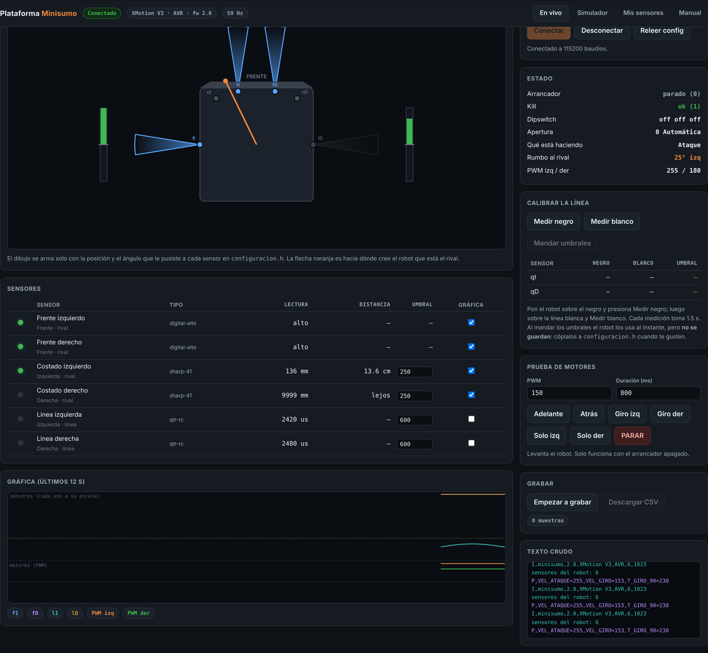
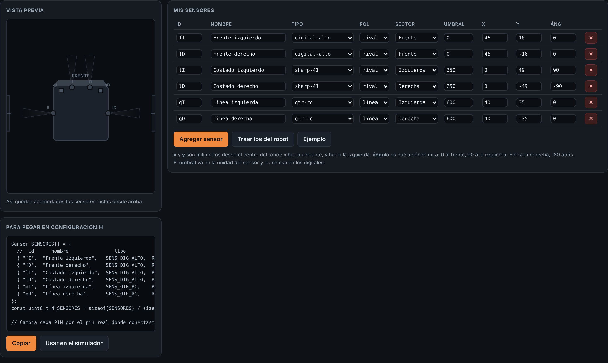
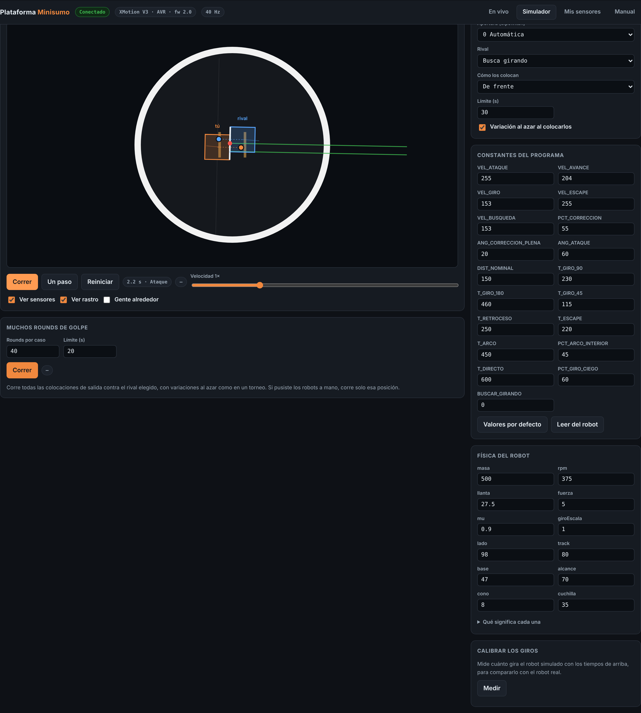

# Minisumo — firmware multiplaca + plataforma de pruebas

Un robot minisumo completo: el programa que pelea y una plataforma web para
ver qué están leyendo sus sensores, probar los motores y simular combates.

- **Funciona en cualquier tarjeta** con el core de Arduino: Arduino Uno, Nano,
  Pro Mini, JSumo XMotion V3, ESP32, STM32 y las que agregues.
- **Los sensores los declaras tú**: cuántos quieras, del tipo que quieras,
  mezclados. Infrarrojos digitales, Sharp analógicos, QTR de línea,
  ultrasónicos. El programa se acomoda solo.
- **La plataforma se arma sola**: le pregunta al robot qué sensores tiene y
  dibuja exactamente los tuyos, con sus distancias en centímetros.
- **Simulador** con el mismo programa del robot, para probar estrategias sin
  gastar batería.



---

## Tabla de contenido

1. [Qué necesitas](#qué-necesitas)
2. [Bajar el proyecto a tu computadora](#bajar-el-proyecto-a-tu-computadora)
3. [Subir el firmware](#subir-el-firmware)
4. [Abrir la plataforma](#abrir-la-plataforma)
5. [Configurar tu robot](#configurar-tu-robot)
6. [Tipos de sensor](#tipos-de-sensor)
7. [Placas que ya vienen listas](#placas-que-ya-vienen-listas)
8. [Primera prueba, paso a paso](#primera-prueba-paso-a-paso)
9. [Cómo pelea el robot](#cómo-pelea-el-robot)
10. [El simulador](#el-simulador)
11. [Protocolo](#protocolo)
12. [Problemas comunes](#problemas-comunes)
13. [Git desde cero](#git-desde-cero)
14. [Estructura del proyecto](#estructura-del-proyecto)

---

## Qué necesitas

| Qué | Para qué |
|---|---|
| [Arduino IDE](https://www.arduino.cc/en/software) | subir el firmware a la placa |
| Chrome, Edge u Opera | abrir la plataforma (Firefox y Safari no sirven, no tienen Web Serial) |
| Un cable USB de datos | conectar la placa; ojo, muchos cables baratos son solo de carga |
| [Git](https://git-scm.com/downloads) | opcional, solo si quieres clonar en vez de descargar un zip |

---

## Bajar el proyecto a tu computadora

### La forma fácil, sin saber git

1. Entra al repositorio en GitHub.
2. Botón verde **Code** → **Download ZIP**.
3. Descomprime el zip donde quieras.

Listo, ya tienes todo. La desventaja es que para actualizar tienes que volver
a bajar el zip.

### Con git (recomendado)

Abre una terminal. En Windows es **Git Bash** (viene con Git) o PowerShell; en
Mac y Linux es la Terminal normal. Escribe:

```bash
cd Documentos
git clone https://github.com/USUARIO/minisumo.git
cd minisumo
```

Cambia `USUARIO` por el nombre de la cuenta de GitHub donde está el repo.
`git clone` baja una copia completa del proyecto en una carpeta nueva llamada
`minisumo`.

Para traer los cambios más nuevos, otro día:

```bash
cd Documentos/minisumo
git pull
```

Si nunca has usado git, salta a [Git desde cero](#git-desde-cero), que explica
todo con calma.

---

## Subir el firmware

1. Abre `firmware/minisumo/minisumo.ino` con el Arduino IDE. Se van a abrir
   varias pestañas: ésa es la normal, son los archivos del proyecto.
2. Edita **solo** la pestaña `configuracion.h`.
3. En **Herramientas → Placa**, elige la tuya:

   | Tu tarjeta | Qué elegir en el IDE |
   |---|---|
   | JSumo XMotion V3 | Arduino Leonardo |
   | Arduino Uno | Arduino Uno |
   | Arduino Nano | Arduino Nano (y el procesador correcto: *ATmega328P* o *Old Bootloader*) |
   | ESP32 DevKit | ESP32 Dev Module |
   | STM32 Blue Pill | Generic STM32F1 series → BluePill F103C8 |

   Para ESP32 y STM32 primero hay que instalar su soporte en
   **Herramientas → Placa → Gestor de tarjetas**.
4. **Herramientas → Puerto**: elige el puerto donde está tu placa.
5. Presiona **Subir**.

---

## Abrir la plataforma

Entra a la carpeta `plataforma` y dale **doble clic a `index.html`**. Se abre en
tu navegador. No necesitas servidor ni internet.

Si tu navegador por defecto es Firefox o Safari, ábrelo a propósito con Chrome:
clic derecho sobre el archivo → Abrir con → Chrome.

Después presiona **Conectar** y elige el puerto de tu placa. Si no aparece
ninguno, revisa [Problemas comunes](#problemas-comunes).

> **Importante:** el Monitor Serie del Arduino IDE tiene que estar **cerrado**.
> Solo un programa a la vez puede usar el puerto.

---

## Configurar tu robot

Todo está en `firmware/minisumo/configuracion.h`. Tiene cinco partes:

### 1. Tu placa

```cpp
#define PLACA  PLACA_XMOTION_V3
```

Las opciones están en la [tabla de placas](#placas-que-ya-vienen-listas). Si tu
tarjeta no está, usa `PLACA_PERSONAL` y define los pines tú mismo; el archivo
te dice exactamente cuáles.

### 2. Los motores

```cpp
#define INVERTIR_IZQ           false
#define INVERTIR_DER           false
#define INTERCAMBIAR_MOTORES   false
```

No adivines: pruébalos desde la plataforma y ajusta según lo que veas.

### 3. Tus sensores

Aquí está lo bueno. Una línea por sensor:

```cpp
Sensor SENSORES[] = {
  //  id      nombre largo          tipo           rol           sector      pin  pin2 umbral   x    y   ang
  { "fI", "Frente izquierdo",  SENS_DIG_ALTO, ROL_OPONENTE, SEC_FRENTE,  A2,  -1,     0,  46,  16,    0 },
  { "fD", "Frente derecho",    SENS_DIG_ALTO, ROL_OPONENTE, SEC_FRENTE,  A5,  -1,     0,  46, -16,    0 },
  { "lI", "Costado izquierdo", SENS_DIG_ALTO, ROL_OPONENTE, SEC_IZQ,     A1,  -1,     0,   0,  49,   90 },
  { "lD", "Costado derecho",   SENS_DIG_ALTO, ROL_OPONENTE, SEC_DER,      4,  -1,     0,   0, -49,  -90 },
  { "qI", "Linea izquierda",   SENS_QTR_RC,   ROL_LINEA,    SEC_IZQ,     A4,  -1,   600,  40,  35,    0 },
  { "qD", "Linea derecha",     SENS_QTR_RC,   ROL_LINEA,    SEC_DER,      2,  -1,   600,  40, -35,    0 },
};
```

Qué es cada columna:

| Columna | Qué poner |
|---|---|
| **id** | nombre corto, sin espacios, para la gráfica |
| **nombre** | el nombre que quieres ver en la plataforma |
| **tipo** | ver la [tabla de tipos](#tipos-de-sensor) |
| **rol** | `ROL_OPONENTE` para buscar al rival, `ROL_LINEA` para el borde blanco |
| **sector** | `SEC_FRENTE`, `SEC_IZQ`, `SEC_DER` o `SEC_ATRAS` |
| **pin** | el pin donde lo conectaste |
| **pin2** | solo para el HC-SR04: el pin de disparo. En los demás, `-1` |
| **umbral** | en la unidad del sensor; en los digitales no se usa, pon `0` |
| **x, y** | dónde está en el robot, en **milímetros**: x hacia adelante, y hacia la izquierda, (0,0) el centro |
| **ang** | hacia dónde mira, en grados: 0 al frente, 90 a la izquierda, −90 a la derecha, 180 atrás |

Puedes poner los que quieras: dos, seis, diez. El programa trabaja por sectores
y no por sensores sueltos, así que la estrategia no cambia ni una línea.

**Las posiciones y los ángulos no son decoración.** Con ellos el robot calcula
hacia dónde está el rival y corrige el rumbo mientras lo embiste. Mide tu robot
con una regla y pon los números reales.

> **Truco:** en la pestaña **Mis sensores** de la plataforma puedes acomodar
> todo con el mouse y te genera este bloque listo para copiar y pegar.



### 4. Cómo pelea

Velocidades, tiempos de giro y la apertura. Todos vienen comentados.

### 5. Telemetría

La velocidad del puerto y cada cuánto manda datos. Normalmente no se toca.

---

## Tipos de sensor

| Constante | Qué es | Qué entrega | Detecta cuando |
|---|---|---|---|
| `SENS_DIG_ALTO` | digital que da ALTO al ver (JS200XF, JS40F, JS60F) | alto/bajo | está en alto |
| `SENS_DIG_BAJO` | digital que da BAJO al ver (E18-D80NK) | alto/bajo | está en bajo |
| `SENS_ANA_MAYOR` | analógico cualquiera | cuentas del ADC | sube del umbral |
| `SENS_ANA_MENOR` | analógico cualquiera | cuentas del ADC | baja del umbral |
| `SENS_SHARP_41` | Sharp GP2Y0A41SK0F, 4 a 30 cm | **milímetros** | está más cerca que el umbral |
| `SENS_SHARP_21` | Sharp GP2Y0A21YK0F, 10 a 80 cm | **milímetros** | está más cerca que el umbral |
| `SENS_QTR_RC` | QTR-1RC / QTR-8RC de línea | microsegundos | mide menos que el umbral (blanco) |
| `SENS_QTR_ANA` | QTR-1A, CNY70, TCRT5000 | cuentas del ADC | mide menos que el umbral |
| `SENS_HCSR04` | ultrasónico HC-SR04 | **milímetros** | está más cerca que el umbral |

Notas:

- Los Sharp y el HC-SR04 dan distancia de verdad, y el robot la usa para saber
  qué tan cerca está el rival y a cuál creerle cuando dos sensores lo ven.
- **El HC-SR04 es lento**: cada medición tarda hasta 6 ms. Si pones varios al
  frente, el robot reacciona más tarde. Úsalo atrás o para pruebas, no para
  embestir.
- **Los Sharp en placas de 3.3 V** (ESP32, STM32) necesitan un divisor de
  voltaje: su salida puede pasar de 3 V y la entrada no lo aguanta.

---

## Placas que ya vienen listas

| `PLACA` | Tarjeta | Driver | Pines de motor que trae |
|---|---|---|---|
| `PLACA_XMOTION_V3` | JSumo XMotion V3 | integrado | PWM 10/11, dir 12/13 |
| `PLACA_AVR_TB6612` | Uno / Nano / Pro Mini | TB6612FNG | PWM 10/5, in 8,9 / 7,6, STBY 3 |
| `PLACA_AVR_L298` | Uno / Nano | L298N | ENA 10, ENB 5, in 8,9 / 7,6 |
| `PLACA_ESP32_TB6612` | ESP32 DevKit | TB6612FNG | PWM 25/33, in 26,27 / 32,14, STBY 13 |
| `PLACA_STM32_TB6612` | STM32 Blue Pill | TB6612FNG | PWM PA8/PA9, in PB12,PB13 / PB14,PB15 |
| `PLACA_PERSONAL` | la tuya | el que sea | los defines tú |

Cualquier pin se puede cambiar desde `configuracion.h` sin tocar nada más.

Con `PLACA_PERSONAL` eliges la forma del driver:

| `MS_DRIVER` | Cómo es | Pines que pide |
|---|---|---|
| `DRV_PWM_DIR` | 1 PWM + 1 dirección | `PIN_PWM_IZQ`, `PIN_DIR_IZQ`, `PIN_PWM_DER`, `PIN_DIR_DER` |
| `DRV_PWM_2DIR` | 1 PWM + 2 direcciones (TB6612, DRV8833, L298N) | `PIN_PWM_IZQ`, `PIN_IN1_IZQ`, `PIN_IN2_IZQ` y los del otro lado |
| `DRV_2PWM` | 2 PWM, uno por sentido | `PIN_PWM_IZQ`, `PIN_PWM2_IZQ` y los del otro lado |

### Si no tienes módulo arrancador

Pon `#define PIN_START -1`. El robot espera los segundos de
`ESPERA_SIN_ARRANCADOR` al encender y luego pelea solo.

### Si no tienes dipswitch

Pon `#define PIN_DIP1 -1` y elige la apertura con `APERTURA_FIJA`.

---

## Primera prueba, paso a paso

Hazlo en este orden. Cada paso depende del anterior.

**1. ¿Llegan los datos?**
Conecta y mira el contador de Hz arriba. Si marca 0, revisa que la placa sea la
correcta y que el Monitor Serie esté cerrado.

**2. ¿Están bien los sensores?**
Tapa cada sensor con la mano y confirma que se prenda el foquito del que dice su
nombre. Si se prenden cruzados, intercambia los pines en `configuracion.h`.
Si uno nunca se prende, revisa su cableado y que el tipo sea el correcto
(`SENS_DIG_ALTO` o `SENS_DIG_BAJO`: muchos se equivocan aquí).

**3. ¿Giran bien los motores?**
Levanta el robot y usa los botones de prueba.

| Lo que ves | Qué cambiar |
|---|---|
| un motor gira al revés | su `INVERTIR_IZQ` o `INVERTIR_DER` a `true` |
| al pedir *adelante* gira sobre su eje | uno de los dos `INVERTIR_` a `true` |
| al pedir *giro izq* se va a la derecha | `INTERCAMBIAR_MOTORES` a `true` |
| no se mueve nada | revisa la batería, el `PIN_STBY` y que el driver tenga corriente |

**4. Calibra la línea.**
Pon el robot sobre el negro del dohyo, presiona **Medir negro**, luego ponlo
sobre la línea blanca y presiona **Medir blanco**. La plataforma te calcula el
umbral de cada sensor. Presiona **Mandar umbrales** y pruébalo al instante.

> Los umbrales que mandas **no se guardan** en la placa: cuando la apagues
> vuelve a los de `configuracion.h`. Cuando te gusten, cópialos ahí.

**5. Calibra los giros.**
Pon el robot en el piso, dale `T_GIRO_90` desde el botón de prueba de motores
(PWM 153, 230 ms) y mide con un transportador cuánto giró. Ajusta el tiempo
hasta que de verdad sean 90°, y el doble para 180°.

---

## Cómo pelea el robot

Al recibir la señal de arranque hace la **apertura** que elegiste y luego entra
al combate. En el combate repite siempre este orden:

1. **Línea blanca** — manda sobre todo lo demás. Retrocede al 100 % y gira
   rápido alejándose del borde.
2. **Rival a la vista** — calcula el rumbo con todos los sensores que lo están
   viendo. Si está más o menos al frente lo embiste al 100 %, frenando un poco
   la llanta de adentro para corregir. Si está de lado o atrás, gira hacia él.
3. **No ve nada** — avanza al 80 % hasta encontrar la línea o al rival. Con
   `BUSCAR_GIRANDO` en `true` busca girando en su lugar.

### Las ocho aperturas

Se eligen con el dipswitch, o con `APERTURA_FIJA` si no tienes.

| DIP1 | DIP2 | DIP3 | Apertura | Cómo colocar el robot |
|---|---|---|---|---|
| off | off | off | **0** automática | como sea |
| ON | off | off | **1** ataque directo | mirando al rival |
| off | ON | off | **2** giro 90° izquierda | rival a tu izquierda |
| ON | ON | off | **3** giro 90° derecha | rival a tu derecha |
| off | off | ON | **4** giro 180° por la derecha | de espaldas |
| ON | off | ON | **5** flanqueo izquierda | mirando al rival |
| off | ON | ON | **6** flanqueo derecha | mirando al rival |
| ON | ON | ON | **7** giro 180° por la izquierda | de espaldas |

La **automática** decide sola con lo que ve al arrancar: si tiene al rival
enfrente lo ataca, si lo ve de lado gira 90° hacia él, y si no ve nada gira 180°
suponiendo que están de espaldas.

El **flanqueo** es para rivales que salen disparados de frente: gira unos 45°,
los deja pasar y les llega por el costado.

### Sobre el reglamento

El firmware arranca **sin ningún retraso** al recibir la señal, como pide el
reglamento de Robochallenge (regla 4.2), y al recibir el stop frena y se queda
parado. Otros torneos piden esperar 5 segundos: en ese caso agrega la espera
dentro de `loop()`, justo después de `peleando = true`.

---

## El simulador



Corre el **mismo programa** del firmware, traducido línea por línea a
JavaScript, con **tus mismos sensores**. Si conectas el robot, la plataforma le
pide su lista y la usa tal cual.

Sirve para:

- ver si la lógica se atora o si el robot se sale solo;
- comparar aperturas entre sí;
- correr 200 rounds de golpe y ver qué colocación de salida te va peor;
- arrastrar los robots a cualquier parte del dohyo y ver qué pasa desde ahí.

### Lee esto antes de confiar en los números

La física es **aproximada**. Sirve para **comparar opciones entre sí** y para
encontrar errores de lógica, no para predecir cuántos combates vas a ganar.

Antes de sacar conclusiones, calíbralo:

1. Mide con cronómetro cuánto tarda tu robot **real** en girar 90°.
2. En el simulador, presiona **Medir** en *Calibrar los giros*.
3. Ajusta **giroEscala** hasta que la simulación tarde lo mismo. Más alto =
   gira más lento.

De ahí en adelante las comparaciones valen mucho más.

Un detalle que el simulador deja ver: entre más separados estén los ejes de las
llantas, **más le cuesta girar sobre su eje**, porque las cuatro llantas tienen
que patinar de lado. Si tu robot es 4×4, ganas tracción y pierdes velocidad de
giro.

---

## Protocolo

Por si quieres leer los datos con tu propio programa. Todo es texto, una línea
por mensaje, a 115200 baudios.

**La placa manda:**

| Línea | Qué trae |
|---|---|
| `I,nombre,version,placa,arquitectura,nSensores,adcMax` | quién es |
| `S,idx,id,nombre,tipo,unidad,rol,sector,umbral,x,y,ang` | un sensor (manda uno por cada uno) |
| `P,clave=valor,...` | las constantes del programa |
| `D,ms,estado,modo,start,kill,dip,vIzq,vDer,v0,v1,…` | los datos, 40 veces por segundo |
| `E,texto` | eventos: `GO`, `STOP`, `PRUEBA` |

**Tú le mandas:**

| Comando | Qué hace |
|---|---|
| `?` | que vuelva a mandar `I`, `S` y `P` |
| `M,vL,vR,ms` | prueba de motores (solo con el arrancador apagado, máximo 3000 ms) |
| `X` | frena |
| `U,idx,umbral` | cambia el umbral de un sensor al instante |

Los valores de `estado` son: 0 esperando, 1 apertura, 2 línea blanca, 3 ataque,
4 giro al costado, 5 búsqueda, 6 prueba de motores.

La telemetría **nunca traba al robot**: si no hay nadie conectado o el buffer de
salida está lleno, se brinca el envío y sigue peleando. Por eso este firmware
también sirve para competir tal cual.

---

## Problemas comunes

| Qué pasa | Por qué | Solución |
|---|---|---|
| No aparece el botón Conectar, o dice que no hay Web Serial | Firefox o Safari | usa Chrome, Edge u Opera |
| Dice que no hay Web Serial aunque uses Chrome | abriste el archivo dentro de otra página | ábrelo directo, con doble clic |
| No aparece ningún puerto | la placa no está conectada, o el cable es solo de carga | prueba otro cable USB |
| El puerto aparece pero da error al abrir | el Monitor Serie está abierto | ciérralo |
| Conecta pero marca 0 Hz | la placa no está corriendo este firmware, o elegiste mal la placa en el IDE | vuelve a subir el programa |
| Conecta, llegan datos, pero no salen los sensores | se perdieron las líneas `S` al arrancar | presiona **Releer config** |
| Los sensores se prenden cruzados | los pines están intercambiados | cámbialos en `configuracion.h` |
| Un sensor siempre detecta, o nunca | tipo equivocado | prueba `SENS_DIG_ALTO` en vez de `SENS_DIG_BAJO` o al revés |
| Un motor gira al revés | el cableado | pon su `INVERTIR_` en `true` |
| Los motores no se mueven en la prueba | el arrancador está en GO | apágalo |
| En ESP32 los motores vibran o no arrancan | el driver no soporta 20 kHz | baja `MS_PWM_FREQ` a 5000 en `configuracion.h` |
| El robot se sale del dohyo | el umbral de línea está mal, o `T_RETROCESO` es muy corto | recalibra la línea y sube el tiempo |
| En Arduino Uno no compila por falta de memoria | demasiados sensores con nombres largos | acorta los nombres |

---

## Git desde cero

Si nunca has usado git, esto es lo mínimo para trabajar con este proyecto.

### Qué es

Git guarda la historia de tu proyecto: cada vez que haces un cambio importante
le tomas una "foto" (un **commit**). Si algo se rompe, puedes volver a
cualquier foto anterior. GitHub es una página donde esas fotos viven en
internet para que no se pierdan y otros las puedan ver.

### Instalarlo

- **Windows:** descarga de [git-scm.com](https://git-scm.com/downloads) y dale
  siguiente a todo. Te instala también **Git Bash**, que es la terminal que vas
  a usar.
- **Mac:** abre la Terminal y escribe `git --version`; si no lo tienes, te
  ofrece instalarlo.
- **Linux:** `sudo apt install git`

La primera vez, dile quién eres (esto va en cada commit):

```bash
git config --global user.name "Tu Nombre"
git config --global user.email "tu@correo.com"
```

### Clonar este proyecto

```bash
cd Documentos
git clone https://github.com/USUARIO/minisumo.git
cd minisumo
```

### Subir tus propios cambios

Si éste es **tu** repositorio y cambiaste algo:

```bash
git status                       # qué archivos cambiaste
git add .                        # prepara todos los cambios
git commit -m "ajusto umbrales de linea"   # toma la foto
git push                         # la sube a GitHub
```

El mensaje del commit debe decir **qué cambiaste**, no "cambios" ni "update".
Dentro de seis meses lo vas a agradecer.

### Crear el repositorio en GitHub por primera vez

1. Entra a [github.com](https://github.com) y crea una cuenta si no tienes.
2. Botón **+** arriba a la derecha → **New repository**.
3. Ponle nombre (por ejemplo `minisumo`), déjalo **Public** y **no** marques
   nada más. Presiona **Create repository**.
4. En tu terminal, dentro de la carpeta del proyecto:

```bash
git init
git add .
git commit -m "primera version del minisumo"
git branch -M main
git remote add origin https://github.com/TU_USUARIO/minisumo.git
git push -u origin main
```

GitHub te va a pedir usuario y contraseña. **Ojo: la contraseña de tu cuenta ya
no funciona ahí.** Tienes que crear un *token*: entra a tu foto de perfil →
Settings → Developer settings → Personal access tokens → Tokens (classic) →
Generate new token, marca la casilla `repo`, cópialo y úsalo como contraseña.
Guárdalo porque solo se ve una vez.

### Los comandos que vas a usar siempre

| Comando | Qué hace |
|---|---|
| `git status` | qué cambiaste desde la última foto |
| `git add .` | prepara todos los cambios |
| `git commit -m "mensaje"` | toma la foto |
| `git push` | la sube a GitHub |
| `git pull` | baja lo que esté más nuevo en GitHub |
| `git log --oneline` | la lista de fotos anteriores |
| `git diff` | qué cambió exactamente, línea por línea |

### Si algo sale mal

| Qué pasó | Qué hacer |
|---|---|
| Rompiste un archivo y quieres volver atrás | `git checkout -- nombre_del_archivo` |
| Quieres deshacer el último commit pero sin perder los cambios | `git reset --soft HEAD~1` |
| `git push` dice que hay cambios en GitHub que no tienes | `git pull` primero, luego `git push` |
| Te perdiste del todo | copia tu carpeta a otro lado, borra la original y vuelve a clonar |

---

## Estructura del proyecto

```
minisumo/
├── README.md
├── LICENSE
├── firmware/
│   └── minisumo/
│       ├── minisumo.ino        el programa principal: estrategia y combate
│       ├── configuracion.h     <<< EL ÚNICO QUE DEBES EDITAR
│       ├── constantes.h        los nombres que usas en configuracion.h
│       ├── placas.h            perfiles de placa, PWM y ADC de cada micro
│       ├── sensores.h          lectura de cada tipo de sensor
│       ├── motores.h           maneja los motores con cualquier driver
│       └── telemetria.h        manda los datos por USB
├── plataforma/
│   ├── index.html              ábrelo con doble clic (archivo único)
│   └── src/
│       ├── plantilla.html      la página sin el simulador adentro
│       ├── motor_sim.js        el motor de simulación
│       └── build.sh            arma index.html juntando los dos
└── docs/                       imágenes del README
```

Si editas algo en `plataforma/src/`, corre `./build.sh` para volver a armar
`index.html`. Si solo quieres usar la plataforma, no necesitas nada de eso.

---

## Licencia

MIT: úsalo, cámbialo y compártelo como quieras. Si te sirvió para ganar algo,
se agradece que lo menciones.
